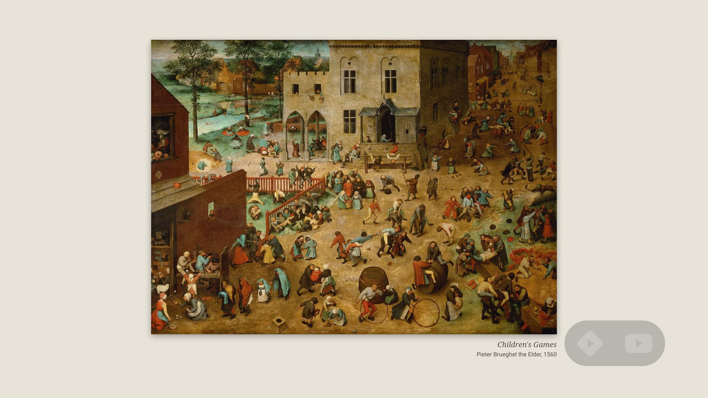

# Canvas

Frame's idea for a Hisense CanvasTV with Google TV. Canvas doesn't replace Art Mode, it adds three
things to it:



*Brueghel's Children's Games (1560), one of Canvas's paintings in Art Mode, with the two icons in
the lower right. A composite: Art Mode draws its picture on a video layer that screenshots can't
capture, so this is the uploaded painting file under the icon overlay from a real screenshot.*

- **Two small icons over Art Mode.** Stremio and SmartTube sit in the lower right corner as one-color
  icons, fainter than Frame's, on a faint dark pill, whenever Art Mode is showing a picture. They
  hide while one of Art Mode's menus or galleries is open, so Down works there as usual. Art Mode
  keeps the remote. Over a picture only **Down** is taken: it moves focus onto the icons. Then
  **Left/Right** choose, **OK** opens, and **Back**, **Up** or 8 idle seconds give the remote back. Any
  other key goes to Art Mode as usual.
- **Public-domain paintings in Art Mode's photo collection.** These are the same ~860 notable paintings as
  Frame's (Art Institute of Chicago, the Met, Cleveland Museum of Art, Wikidata/Wikipedia), with the
  same filter for violent and explicit works. Each is saved as a 3840 x 2160 JPEG with the painting
  whole on a plain mat and a small label (title, artist) under it, so Art Mode can't crop a tall
  painting. Canvas keeps 60 on the TV, four new ones a day, and `./install.sh upload` adds the new
  ones to Art Mode's collection through its add-from-phone page. Your own photos are left alone.
- **Art Mode in the evening.** At 18:00 the TV turns on into Art Mode, and at 20:00 Art Mode turns
  off. In between, Hisense's own **Motion detector** (Art Mode settings) blanks the screen when the
  room is empty and brings it back when someone walks in. It never interrupts the TV while it's in
  use (another app on screen), and turns it on only once an evening, so a TV you turn off stays off.

No libraries. The only servers it talks to are the four art collections.

`build/canvas.apk` is prebuilt. You only need `adb` to install it.

## Install

On the TV: Settings > System > About, press OK on **Android TV OS build** 7 times. Then in Settings >
System > Developer options, turn on **USB debugging** and network debugging (named "Wireless
debugging" or "ADB over network" on some builds). The TV's IP is in Settings > Network & Internet.
Install Stremio and SmartTube first (Play Store or Downloader).

```bash
export TV_HOST=192.168.1.60
./install.sh            # installs; turns on the overlay service, the screen-off permission and storage
# now open Art Mode on the TV (press the remote's power button, or open the Art Mode app), then:
./install.sh learn      # remembers Art Mode, lists its screens and folders that may hold its photos
./install.sh upload http://<TV>:<port>/<code>   # with Art Mode's add-from-phone screen open
./install.sh status
```

`learn` has to run once, with Art Mode on screen, because Hisense doesn't document Art Mode's package
name. It decides when the icons show and what the evening schedule opens.

## Photo collection

Art Mode keeps its photo collection (Photo Collections > My Photos) in its own private storage,
`/data/data/com.vt.arttv.artmode/photos`, which no other app can write to. The way in is the one
your phone uses: Art Mode's **add from phone** screen (Photo Collections > My Photos > +) runs a small
web page on the TV, and its QR code holds the address, like `http://192.168.1.60:18080/123456`. The
number at the end changes each time the screen opens. While it's open:

```bash
./install.sh upload http://192.168.1.60:18080/123456
```

That sends every painting Canvas has saved and hasn't sent yet, the way the phone page does, and
Art Mode shows "Import completed". Canvas keeps its paintings in `/sdcard/Pictures/Canvas Art` and
remembers what it sent in `.uploaded` there, so running it again later only sends the new ones.
Paintings in Art Mode stay until you delete them there, like your own photos.

```bash
./install.sh art sync        # save 12 more now (the background job saves the rest, every 3 hours)
./install.sh art off         # delete Canvas's saved paintings (not the ones already in Art Mode)
./install.sh mat '#1E1D1B'   # a dark mat (the labels turn light); mat off saves the painting alone
```

## Evening schedule and the presence sensor

```bash
./install.sh schedule 18:00-20:00   # or off; a window past midnight (22:00-01:00) works too
./install.sh start | sleep | tick   # try it now: Art Mode on, off, or one schedule check
```

**The sensor.** The CanvasTV's presence sensor is a radar run by Hisense's own system service, not
an Android sensor (Android lists no sensors at all on the 55S7N). Its service only answers
Hisense's apps: the TV's SELinux rules refuse a sideloaded app (`avc: denied { find }` for
`hal_systemmw_hwservice`). So Canvas doesn't read it. Turn on **Motion detector** in Art Mode's
settings instead: Art Mode then blanks the screen when the room is empty and wakes it when someone
comes in, and Canvas only decides when the evening starts and ends. Hisense's blank screen only turns
the panel off: Android stays awake with Art Mode on screen. So at 20:00 Canvas still sees Art Mode and
puts the TV into standby, even if the room was empty. Whether the motion detector can wake the TV
from standby hasn't been tested yet.

**Turning on and off.** To turn the TV on, Canvas uses a wake lock that turns the screen on and opens
Art Mode. This works when the TV is in standby (Android asleep), which is how Google TV sets usually
turn off. If the TV was unplugged, or Google TV's energy settings shut it down fully, nothing runs
until it starts again. To turn it off, Canvas uses Android's `lockNow`, which sleeps the TV like the
power button. That needs the device admin `install.sh` turns on.

## Change things

- **Apps:** `res/values/apps.xml`, as in Frame. `app_icons` names the glyph drawn in `AppGlyph.java`.
- **Focus key:** `./install.sh key DPAD_UP` (or `MENU`, `INFO`...) if Art Mode needs Down for itself.
- **Look:** sizes and colors at the top of `Overlay.java` (icons) and `Mat.java` (mat and label).
- **Rebuild:** `./build.sh`, then `./install.sh`. It needs the same tools as Frame's build. It signs with
  Frame's key (`../signing/frame.jks`), so updates install over the old version.

## How it works, and what it can't do

- **The icons** come from an accessibility service (`Overlay.java`). It's the one kind of sideloaded
  app that can see which app is on screen, draw over it (`TYPE_ACCESSIBILITY_OVERLAY`, no "display
  over other apps" permission) and see remote presses before Art Mode does. `install.sh` turns it on
  with `settings put secure enabled_accessibility_services`. If Art Mode is a screensaver (dream) on
  your firmware rather than an app, `learn` says so. The icons may still show, but the schedule can't
  start it.
- **Starting apps from the background** is allowed because the accessibility service is on. If you
  turn it off in Settings > Accessibility, the icons and the schedule stop.
- **Storage:** Canvas targets Android 10 (API 29) with legacy external storage, so it can write to a
  shared folder with the plain storage permission `install.sh` grants.
- **Tested on a 55S7N CanvasTV** (Google TV 12): Art Mode is `com.vt.arttv.artmode/.ArtModeActivity`,
  and the icons draw over it. Its photo collection only takes uploads, hence `upload`. Other models
  may differ, so `learn` finds Art Mode on each TV, and `findphotos` (run within 30 minutes of adding
  a photo from the phone) shows whether a model keeps its photos in a shared folder instead, for
  `./install.sh photos DIR`.

## Troubleshooting

| What you see | What to do |
|---|---|
| No icons over Art Mode | `./install.sh status`: the first line says whether the overlay service is on, and "on screen now" must match the Art Mode line. If they differ (Art Mode moved to another screen), run `learn` again with Art Mode showing. |
| Down does something in Art Mode you need | `./install.sh key DPAD_UP` (or another key). |
| "Can't write there" in status | `./install.sh` again (it grants storage), or pick a folder under `/sdcard`. |
| Paintings saved but not in Art Mode | They go in with `./install.sh upload` while the add-from-phone screen is open. See [Photo collection](#photo-collection). |
| `upload` says the page didn't answer | The screen closed, or the address changed: open it again and use the new QR address. |
| TV doesn't come on at 18:00 | `./install.sh status` shows the next check, and whether it already turned the TV on this evening. Then `./install.sh start` with the TV off checks that turning on works on your firmware. `adb logcat -s Canvas` shows every decision. |
| Art Mode blanks with people in the room | That's Hisense's Motion detector: change its sensitivity or delay in Art Mode's settings, or turn it off. |
| `remove` says the app can't be uninstalled | The device admin is still on: Settings > Security > Device admin apps, turn Canvas off, then `adb uninstall com.canvashome`. |

## Undo

`./install.sh remove` deletes Canvas's paintings, turns off its accessibility service and device admin,
and uninstalls it. Art Mode and your own photos stay as they were.
